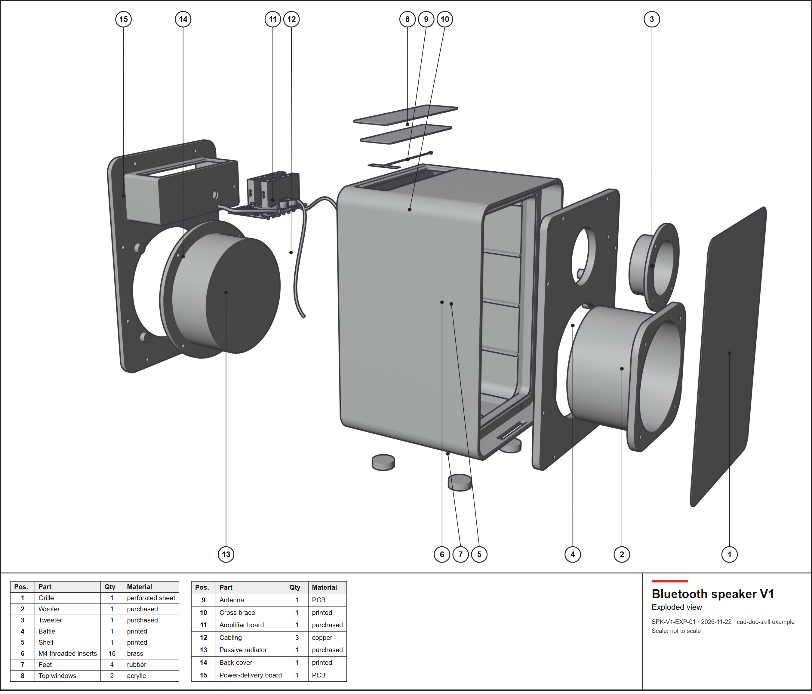
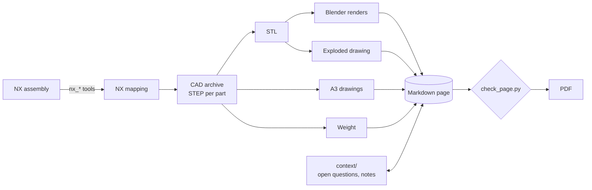
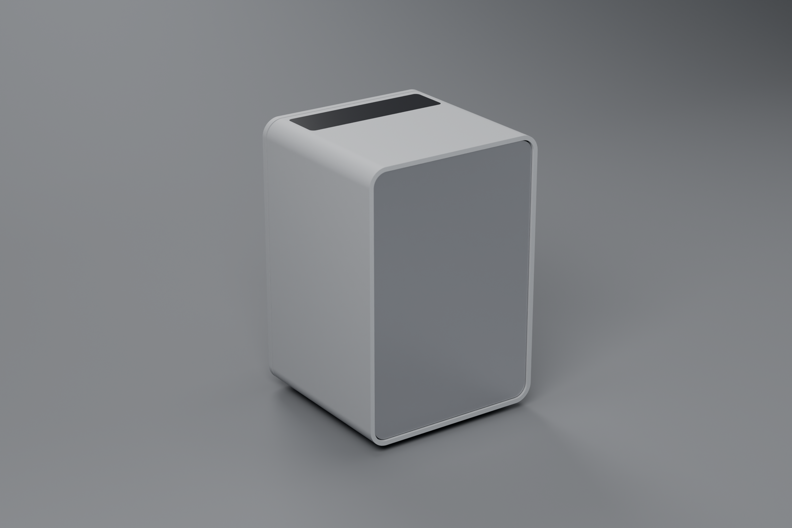
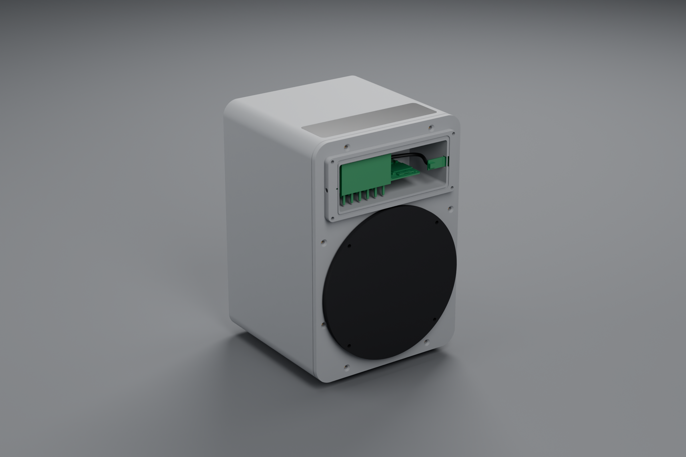
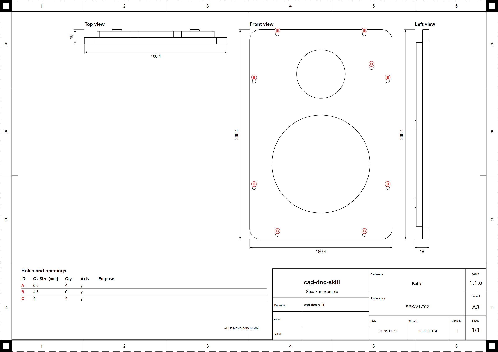

# cad-doc-skill

**Living engineering documentation for CAD assemblies, written by an agent while you design.**
A [Claude Code](https://claude.com/claude-code) skill that turns a Siemens NX assembly (or any STEP model) into a documented, reviewable Markdown page: decisions with history, renders, exploded views, location images, drawings, weight and rule checks, open questions.



<sub>Exploded drawing generated by the skill's tools from the example model (`examples/speaker/`): Blender Freestyle outlines, projected part anchors, balloons and parts list composed in HTML and rasterised with a headless browser.</sub>

## Why I built this

I wrote this while documenting a Formula Student electric race car. Formula Student is a student engineering competition in which teams design, build and race a single-seater every year. The team changes every season, so the real product is not only the car but the knowledge that survives to the next one. In practice that knowledge rots in three places: the CAD drifts away from the documentation, decisions are remembered but their reasons are not, and renders and drawings are made by hand once and never again.

The fix I settled on is to make documentation a by-product of design instead of a task after it:

- the page is written **in the same step as the change**, never later,
- every number has a **source** or is `TBD`, nothing is invented,
- geometry is exported **once** into an archive and everything downstream (STL, renders, drawings, weights) is generated from that archive,
- a **checker** enforces form and arithmetic, so a page that passes is at least internally consistent.

The skill encodes that process for an agent. The scripts do the deterministic parts.

## What it does

| Stage | What happens | Tooling |
|---|---|---|
| NX mapping | find and confirm how assembly and parts are named in NX | NX MCP connector or by hand |
| CAD archive | one STEP per part in assembly coordinates, stored once | NX, FreeCAD |
| Renderings | studio renders, exploded views, orientation-checked | Blender (Cycles), `render_assembly.py` |
| Exploded drawing | line-art view with numbered balloons and parts list | Blender Freestyle, `callouts.py` |
| Location images | where the part sits in the whole product and in its module | NX connector, Blender |
| Drawings | multi-view A3 sheets with hole table | FreeCAD, `part_drawing.py` |
| Weight and rules | volume x density, rulebook compare with changes highlighted | `volume.py`, skill rules |
| Engineering | goals, variants, weighted matrix, design calculation, FMEA, simulation fact sheets | `references/engineering.md` |
| Open questions and notes | running lists outside the page, read before every session | `context/` |
| Check | structure, status, history, arithmetic, links, image rules | `check_page.py` |
| PDF | optional A4 export of a finished page | `md2pdf.py` |



## Works with the NX connector

The NX side is done by a separate project: **[skyf0l/siemens-nx-mcp](https://github.com/skyf0l/siemens-nx-mcp)** (MIT), an MCP server that lets Claude drive a running Siemens NX session. This skill does not ship it and does not depend on it, but uses it when it is configured: `nx_list_components` and `nx_list_objects` for the mapping, `nx_open_part` and the export tools for the CAD archive, `nx_capture_view` for location images. Without the connector the skill asks you for the part list and STEP files and carries on, because everything after the export works from STEP.

Setup, tool list and the failure modes I ran into (modal dialogs, partially loaded assemblies, hidden helper bodies in STEP exports) are in [docs/nx-connector.md](docs/nx-connector.md). All credit for the connector goes to its authors.

## Install

```powershell
git clone https://github.com/Zytow/cad-doc-skill
cd cad-doc-skill
python install.py --project ..\my-docs --mcp ..\my-docs
```

`install.ps1` and `install.sh` are thin wrappers around `install.py`. It copies the skill to `~/.claude/skills/cad-doc`, optionally prepares a documentation project (vault template, `tools/`, `context/`, a `CLAUDE.md` block) and writes an `.mcp.json` entry for the connector, then prints which of Python, FreeCAD, Blender, a Chromium-based browser and `uv` it found.

Then open Claude Code in the project and say which assembly you are documenting. The skill triggers on its own whenever an assembly is designed, calculated, simulated or decided.

Requirements: Python 3.9+. For the full pipeline FreeCAD 1.x (`freecadcmd`), Blender 4.x or 5.x and Microsoft Edge or Chromium. NX and its connector are optional.

## Project layout the skill maintains

```
doc/<assembly>/<assembly>.md      the page
doc/<assembly>/images/            renders and photos
doc/<assembly>/drawings/          PDF and PNG per sheet
doc/<assembly>/datasheets/        datasheets
doc/<assembly>/cad/step/          one STEP per part, assembly coordinates
context/                          open questions, notes, assembly context, image control
tools/                            the scripts, copied from the skill
```

## Example

[`examples/speaker/`](examples/speaker/) is a complete page for a two-way bluetooth speaker: NX mapping, as-built table, renders, the exploded drawing above and an A3 drawing of the baffle. It passes the checker with 0 errors and 0 warnings, and its `TBD` entries are honest: values I have not measured are not on the page.

| Product | Rear |
|---|---|
|  |  |



The CAD model itself is not published, only the renders and the text. The driver and board models are purchased parts from their manufacturers.

## Rules the checker enforces

`python skills/cad-doc/scripts/check_page.py doc/<assembly>/<assembly>.md`

Errors: empty sections, missing status or history on a decision, a wrongly summed evaluation matrix or RPN, an incomplete simulation fact sheet, dead links, missing images, invalid frontmatter. Warnings: missing location image, meta phrases such as "presumably" or "according to", oversized images, files outside the assembly folder. `TBD` is listed, never hidden. Pages from before the format use `--legacy`, the exact template outline `--template`. Unit tests are in `tests/`.

## Documentation

[Architecture](docs/architecture.md) · [Workflow](docs/workflow.md) · [NX connector](docs/nx-connector.md) · [Conventions](docs/conventions.md) · [Customizing](docs/customizing.md) · [FAQ](docs/faq.md) · [Contributing](CONTRIBUTING.md)

## Credits and license

MIT, see [LICENSE](LICENSE). The NX connector is [skyf0l/siemens-nx-mcp](https://github.com/skyf0l/siemens-nx-mcp). Rendering uses [Blender](https://www.blender.org), geometry processing [FreeCAD](https://www.freecad.org). Siemens NX is a trademark of Siemens; this project is not affiliated with or endorsed by Siemens, Anthropic, Blender or FreeCAD.
