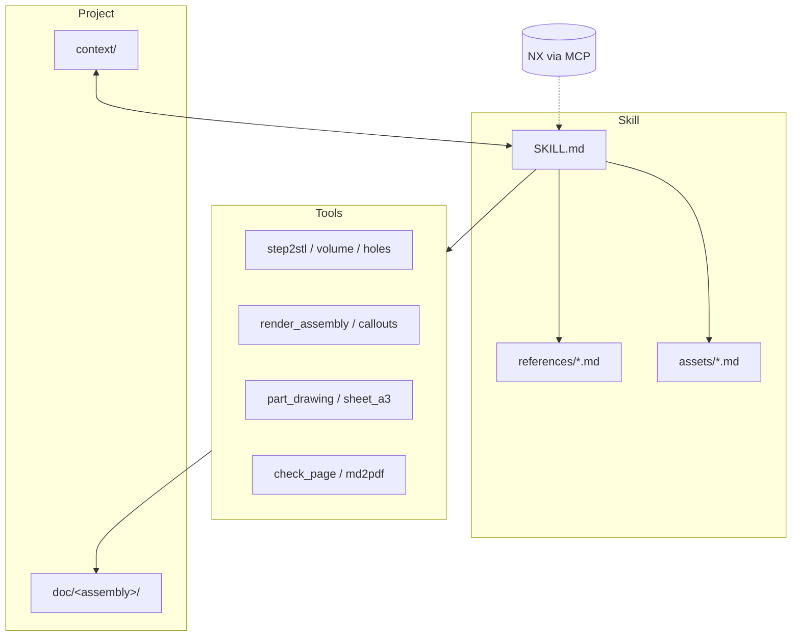

# Architecture

The repository has three layers.

1. **The skill** (`skills/cad-doc/`). `SKILL.md` is loaded when an assembly is designed. It tells the agent the process and points to `references/` (one topic per file, read on demand) and `assets/` (outline skeletons). This is progressive disclosure: only the topics needed for the current step enter the context.
2. **The tools** (`skills/cad-doc/scripts/`). Deterministic Python that does what an agent should not improvise: STEP to STL, volumes, hole detection, Blender renders, A3 drawings, the exploded-drawing sheet, PDF export, and `check_page.py`. They are copied into the project as `tools/` and resolve paths relative to the project.
3. **The project** (`templates/vault/`). A plain folder, an Obsidian vault if you like. Pages in `doc/`, memory in `context/`.

## Data flow

`NX` -> STEP per part (assembly coordinates) in `doc/<assembly>/cad/step/` -> STL in `nx/export/` -> Blender shots described by one JSON file per assembly (`tools/render/<assembly>.json`) -> PNG in `doc/<assembly>/images/`. STEP is the only interface to the CAD system. That is why the skill works without NX.

## Why a checker

Agents are good at writing and unreliable at bookkeeping. Everything that can be verified mechanically is: structure, status values, history tables, matrix sums, RPN products, simulation fact sheets, links, image sizes. What stays with the agent and the engineer is whether the content is true.

## Why `context/` lives outside the pages

Open questions and user notes are working memory, not documentation. Keeping them next to, not inside, the pages keeps the pages free of hedging, and gives the agent one place to read before every session.
