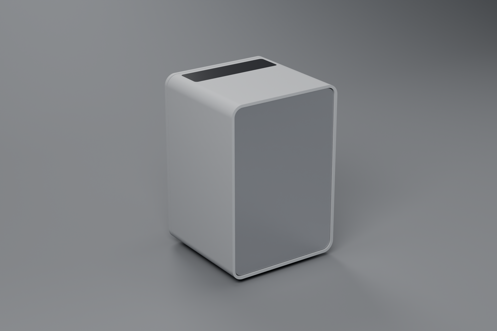
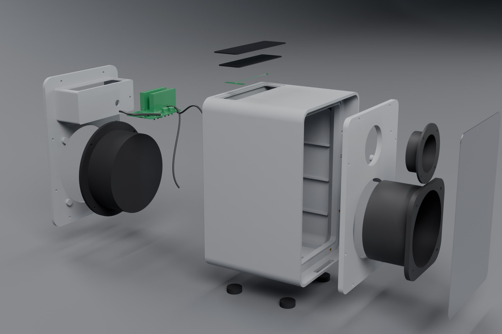
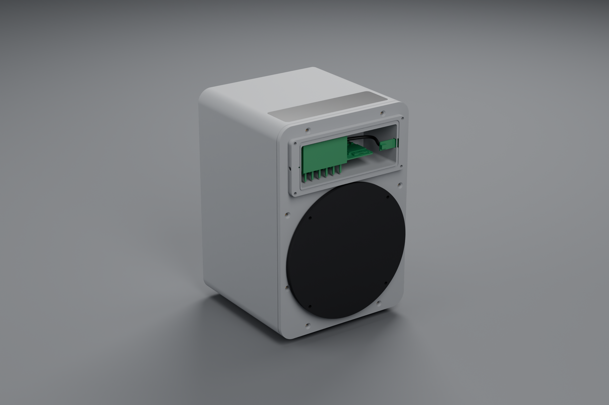
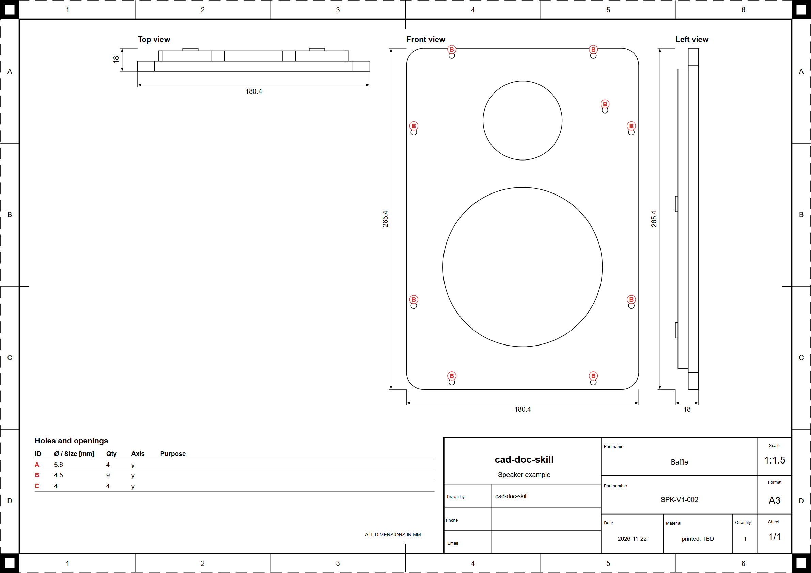
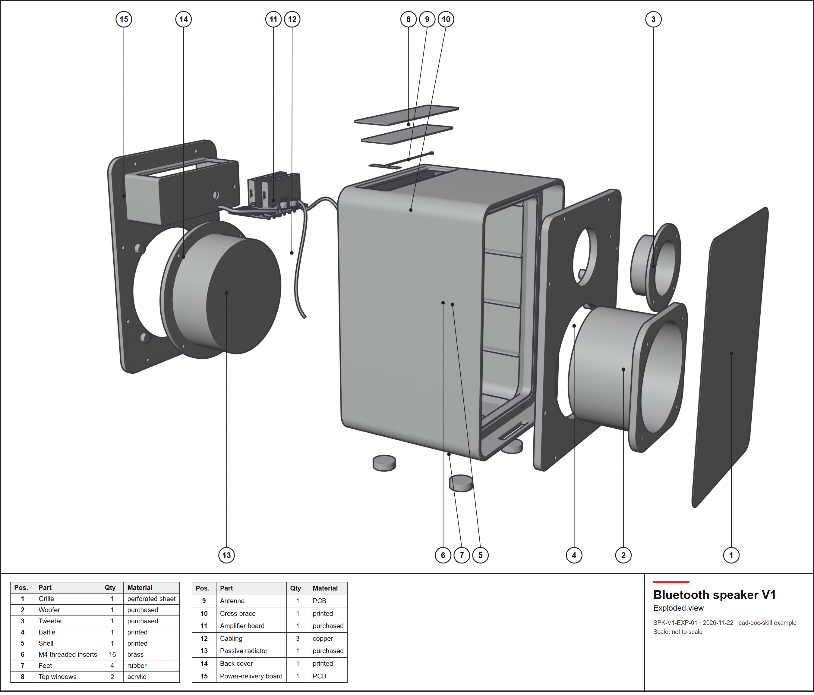

:::info
Live documentation V2, created on 2026-11-22

:::

# Overview

A two-way bluetooth speaker in a printed enclosure: woofer and tweeter on a common baffle, a passive radiator in the back cover, an amplifier board and a power-delivery board inside. The page is the example documentation of the cad-doc skill and was produced with its tools from the CAD model.

### NX mapping

Top-level assembly: `LS_Baugruppe`. Confirmed on 2026-11-22.

| Part | Role | Name in NX | Path in the assembly |
|---|---|---|---|
| Assembly | whole speaker | `LS_Baugruppe` | top level |
| Shell | printed part | `MANTEL` | `LS_Baugruppe/MANTEL` |
| Baffle | printed part | `SCHALLWAND` | `LS_Baugruppe/SCHALLWAND` |
| Back cover | printed part | `RUECKDECKEL` | `LS_Baugruppe/RUECKDECKEL` |
| Cross brace | printed part | `QUERSTREBE` | `LS_Baugruppe/QUERSTREBE` |
| Grille | made part | `GITTER` | `LS_Baugruppe/GITTER` |
| Woofer | purchased part | `TIEFTOENER` | `LS_Baugruppe/TIEFTOENER` |
| Tweeter | purchased part | `HOCHTOENER` | `LS_Baugruppe/HOCHTOENER` |
| Passive radiator | purchased part | `PASSIVRADIATOR` | `LS_Baugruppe/PASSIVRADIATOR` |
| Amplifier board | purchased part | `LOUDER_PLATINE` | `LS_Baugruppe/LOUDER_PLATINE` |
| Power-delivery board | purchased part | `PD_PLATINE` | `LS_Baugruppe/PD_PLATINE` |
| Antenna | purchased part | `ANTENNE` | `LS_Baugruppe/ANTENNE` |
| Top windows | made part | `ASA_FENSTER_FACH`, `ASA_FENSTER_MANTEL` | `LS_Baugruppe/...` |
| Feet | purchased part | `FUSS_1` to `FUSS_4` | `LS_Baugruppe/...` |
| Threaded inserts | purchased part | 16 x `RX_H`, `RX_V` (M4) | `LS_Baugruppe/...` |
| Cabling | purchased part | `KABEL_VERDRAHTUNG` | `LS_Baugruppe/KABEL_VERDRAHTUNG` |

# V1 generation

* Owner V1: TBD
* Material V1: TBD

## As-built V1

| Part | Designation | Type | Dimensions |
|---|---|---|---|
| Shell | `MANTEL` | printed part | 190 x 175 x 275 mm |
| Baffle | `SCHALLWAND` | printed part | 18 mm thick |
| Woofer | `TIEFTOENER` | purchased part | 134.5 x 84 mm |
| Back cover | `RUECKDECKEL` | printed part | 69 mm deep |

## Mounting V1

**Location in the product:** the speaker is the product, a free-standing unit with the baffle to the front.

**Mounting concept:** the baffle and the back cover are screwed into 16 threaded inserts in the shell; four rubber feet carry the speaker.

## Structure of the enclosure

The shell is a closed printed tube. The baffle closes the front, the back cover with the passive radiator closes the rear, a cross brace stiffens the shell from inside.

### Technical drawings

Baffle on an A3 sheet with dimensions and hole table, made with `tools/part_drawing.py`: [baffle-1.pdf](drawings/baffle-1.pdf).

Exploded view with numbered positions and parts list, generated with `tools/callouts.py`.

### Relevant links

* [siemens-nx-mcp](https://github.com/skyf0l/siemens-nx-mcp)

## Weight V1

| Part | Volume | Density | Mass |
|---|---|---|---|
| Shell | TBD | TBD | TBD |
| **Total** | | | **TBD** |

# Takeaways for V2

* TBD

# Working state V2

## Requirements

| Requirement | Source | Target / value |
|---|---|---|
| Sealed volume of the main chamber | acoustic design | TBD |

## To-dos

- [ ] TBD
